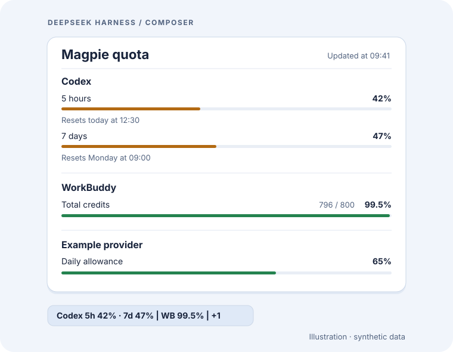

# DSH Magpie Quota Panel

[English](README.en.md)

在 DeepSeek Harness（DSH）Web 会话中查看 Magpie 账号的额度、余额和重置时间。输入框下方的状态栏提供快速入口；展开后可按账号查看明细。无论当前会话是否通过 Magpie 调用模型，都可以使用面板。



*界面示意图，使用虚构额度和账号数据。*

## 数据覆盖范围

面板使用 Magpie 的 `GET /v1/magpie/quotas` 作为数据来源，不维护服务商或订阅计划白名单。新增订阅无需配置 DSH 插件：账号及其额度窗口出现在接口响应后，面板即可读取。可查询的窗口、单位和重置时间取决于 Magpie 及其上游服务；**能调用模型，不代表能查询该账号的额度**。

| 数据类型 | 面板如何展示 |
| --- | --- |
| 滚动或周期额度 | 每个窗口单独显示；有重置时间时一并列出。 |
| 积分余额 | 显示剩余比例；数据足够时显示剩余积分和上限。 |
| 模型限额 | 按窗口名称标识，不与账号余额合并。 |
| 未知读数 | 显示 `—`，不将缺失数据视为额度充足或耗尽。 |

状态栏最多预览两个未过期账号，`+N` 表示还有其他账号。普通账号显示名称，额度在展开面板中查看；部分服务商有专用摘要。比如，Codex 摘要单独列出 5 小时与 7 天窗口；WorkBuddy 摘要显示积分余量，明细最多展示一个模型限额。不同窗口和单位不汇总为一个百分比。

## 安装与使用

**前置条件：**正在运行的 DSH Web、DSH 宿主进程可调用的 `pnpm`，以及从 DSH 宿主可访问的 Magpie 网关。请先在 Magpie 配置要查看的账号。

1. 将源码克隆到准备长期保留的目录：
   ```bash
   git clone https://github.com/PhotoByLucas/dsh-magpie-quota-panel.git
   ```
2. 在 DSH 的插件管理页添加克隆后的目录，并在当前 profile 启用插件。不要移动或删除仍被 DSH 引用的本地目录。
3. 打开一个会话，点击输入框下方的额度入口。如果同时安装了原版额度插件，请先禁用原版，避免重复的状态栏入口。

## 配置

以下选项属于 `magpie-quota` 插件条目的 `config`。默认使用同一台机器上的 Magpie，无需额外配置。

| 配置项 | 默认值 | 说明 |
| --- | --- | --- |
| `baseUrl` | `http://127.0.0.1:3425` | 从 **DSH 宿主**可访问的 HTTP(S) 网关根地址；不要附加 `/v1` 或 `/v1/magpie/quotas`。 |
| `timeoutMs` | `8000` | 单次额度请求的超时，单位为毫秒。接受 `500`–`60000` 的整数。 |

## 数据流与部署边界

浏览器通过 DSH 的同源接口读取额度，DSH 宿主再向 Magpie 请求数据。已挂载的面板约每 60 秒刷新一次；打开明细或切回页面也会触发刷新。刷新失败时，面板会标记已有的旧读数。

当前版本不为 Magpie 额度请求附加认证凭据，建议使用本机回环网关。若你的额度端点要求认证，请保留原有安全设置，不要为了接入面板关闭对外网关的鉴权。额度结果可能包含账号标识；不要在公开 Issue 中提交原始接口响应。

## 故障排查

| 现象 | 检查项 |
| --- | --- |
| 安装时报 `spawn pnpm ENOENT` | 确认 `pnpm` 在 **启动 DSH 的进程**的 `PATH` 上，而不只是交互式终端可用。 |
| 会话中没有额度入口 | 确认插件已在活动 profile 启用，再刷新页面。 |
| 所有读数均不可用 | 确认 Magpie 正在运行，并从 DSH 宿主检查网关是否可达、额度端点是否要求认证。 |
| 只有某个账号或窗口缺失 | 先在 Magpie 检查该账号的额度。如果 Magpie 没返回该窗口，面板不会估算。 |

## 开发与反馈

在仓库根目录运行本地回归测试：

```bash
node test-render-reading.mjs
node test-usable-share.mjs
```

提交问题时，请附上 DSH、Magpie 和插件版本，以及复现步骤和脱敏后的预期与实际读数。请勿附上访问令牌、账号标识或未经脱敏的日志。

## 来源与许可

本项目基于 [Canvai1337/dsh-magpie-quota](https://github.com/Canvai1337/dsh-magpie-quota/tree/be281ec) 独立维护，保留原版权声明，按 [MIT 许可证](LICENSE) 分发。不是 DeepSeek 或 Magpie 的官方插件。
